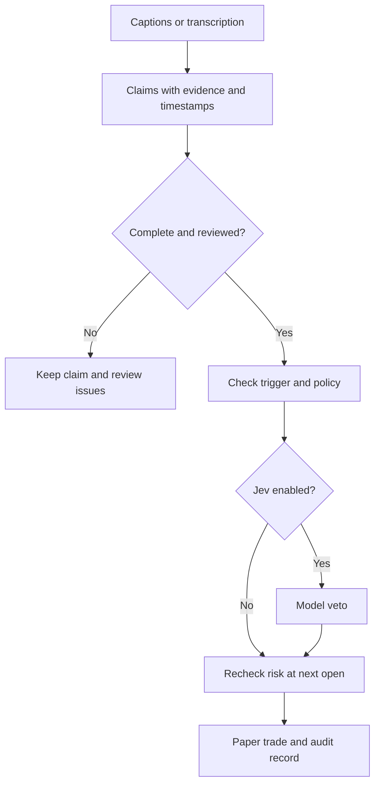

# Signal Decision Lab

Extract trading claims from transcripts, keep the source evidence, and test reviewed setups
in a chronological paper simulation. The optional **Jev adapter uses TypeSafe's System One
API** to judge a narrowly defined action: buy, sell or hold.

The project starts with a practical question: can commentary from channels such as Eric
Krown's be turned into useful, testable trading inputs? The code covers ingestion,
extraction, review and replay. The [research](docs/research/video-signals.md) and
[evaluation plan](docs/EVALUATION.md) describe how to test whether those inputs add value.
A trading advantage has not been established.

## Run it

Python 3.11 or later is enough for the offline demo and tests. Neither needs API keys or
third-party packages.

```bash
git clone https://github.com/larsmartens/signal-decision-lab.git
cd signal-decision-lab
python -m signal_lab demo
python -m unittest discover -s tests -v
```

Open `artifacts/demo/report.html` to inspect six synthetic claims, their evidence, review
results and one completed paper trade. The price series was written to exercise the
simulator. Its return is a fixture result, not a strategy performance estimate.

`python -m pip install -e '.[dev]'` also installs the `signal-lab` command, Ruff and Mypy.
Commands print compact TOON by default; append `--format json` for JSON. Saved run files
always contain the full JSON record.

## What works

| Component | Current behavior | Validation limit |
|---|---|---|
| Transcript import | Reads JSON, WebVTT and SRT with source metadata | Publication and availability times must be supplied accurately. |
| YouTube captions | Optional importer; one real download recorded | Caption access varies by video and environment. |
| Audio and video transcription | Optional `faster-whisper` adapter for local files | No actual ASR model run was completed here. |
| Rule extraction | Recognizes a small set of English BTC/ETH setup patterns | Other wording and unsupported conditions remain unreviewed. |
| LLM extraction | Accepts structured output from a chat-completions endpoint | HTTP and schema tests passed; external model inference is untested. |
| Evidence review | Checks quoted text, price roles and supported conditions | Human approval records a review; it does not prove the claim is correct. |
| Jev | Calls the official API with a pinned model and records both scores | Tested against local HTTP fixtures. Live Jev inference and calibration on these inputs are unverified. |
| Paper replay | Uses completed bars, next-open fills, fees, slippage and risk limits | One asset and one position; no liquidity or order-book model. |
| Evaluation | Computes Brier score, ECE, accuracy and coverage | These measure decision labels, not investment returns. |
| HTML report | Shows evidence, decisions, trades and equity without external assets | Data and escaping tested; visual browser review remains incomplete. |

See [validation](docs/VALIDATION.md) for the tests actually run and the remaining gaps.

## How decisions flow



The rule engine controls eligibility and risk. Jev can veto an eligible entry; it cannot
supply a missing stop, approve an unreviewed claim or override a failed risk check.

## Use your own transcript

Start with the JSON format in `examples/synthetic-transcript.json`, or supply metadata
alongside a subtitle file:

```bash
python -m signal_lab extract examples/captions.vtt \
  --metadata examples/captions-metadata.json --out artifacts/claims.json
python -m signal_lab show artifacts/claims.json --full --format json
```

Extraction leaves every claim unreviewed. A supported setup looks like this synthetic example:

> Buy BTC if the 1h candle closes above 100; stop at 95; target 120; valid for 4 hours.

Missing stops, unresolved corrections, price ranges, ambiguous attribution and extra
conditions prevent approval. Extending that vocabulary requires schema changes and tests.
The LLM adapter uses the same evidence checks.

After checking the source, approve a complete claim and replay it against matching bars:

```bash
python -m signal_lab review --input artifacts/claims.json \
  --signal '<signal ID from show>' --reviewer '<reviewer name>' \
  --out artifacts/reviewed.json
python -m signal_lab replay --signals artifacts/reviewed.json \
  --bars path/to/matching-bars.csv --policy examples/policy.json \
  --out artifacts/replay.json --report artifacts/replay.html
```

Bars must match the asset, venue, period and candle interval of the claim. The example
transcripts are deliberately dated in the past, so importing them today does not make
them current. `--as-of` permits an explicit historical processing assumption for experiments;
that assumption is recorded and does not establish that the information was available then.

## Optional sources and extraction

### YouTube captions

```bash
python -m pip install -e '.[youtube]'
python -m signal_lab import-youtube \
  --url 'https://www.youtube.com/watch?v=EdXslFg3u38' \
  --channel 'Cointelegraph: Krown interview' \
  --published-at '2026-09-02T15:01:27Z' --out data/interview.json
```

A real import of this interview returned 646 automatically generated English caption
segments. The rule baseline found 46 asset mentions and no complete supported setups.
This checks acquisition, not extraction accuracy: the captions were not manually labeled
or independently checked against the audio. The [record](docs/validation/youtube-smoke.json)
contains the fetch time and payload hash. Full third-party transcripts are excluded from git.

### Generative extraction

```bash
export SIGNAL_LLM_BASE_URL='http://127.0.0.1:11434/v1'
export SIGNAL_LLM_MODEL='<installed model>'
python -m signal_lab extract data/interview.json --provider llm \
  --out artifacts/llm-claims.json
```

The endpoint must support chat completions with `response_format: json_object`. Remote
endpoints require HTTPS; credentials come from `SIGNAL_LLM_API_KEY`. `.env.example` is a
reference and is not loaded automatically. A failed request produces an error, not
replacement claims.

For local audio or video, install `.[asr]` and use `python -m signal_lab transcribe --help`.
The first call downloads the chosen Whisper model. Chart images and OCR are not implemented.

## Try Jev

The adapter targets `POST https://api.typesafe.ai/v1/systemone` and pins `jev-1.14.0`.
See [Jev setup](docs/JEV_SETUP.md) for the request format, score definitions and failure handling.

```bash
export TYPESAFE_API_KEY='<your TypeSafe key>'
python -m signal_lab demo --judge jev --out artifacts/jev
```

This explicitly enables a paper experiment. The transcript evidence and current completed
bar are sent to TypeSafe. A missing key, provider error, malformed answer, hold decision or
low selected probability prevents the entry. The default `--judge rules` stays offline.

TypeSafe's `confidence` and the selected label's probability are different values. Both
are retained. The replay threshold applies to the selected probability; the adapter records
`calibrated: false` because calibration has not been measured on this task. No live Jev
request was made during this implementation because no TypeSafe API key was configured.

## Research and next steps

- [Implementation plan](docs/PLAN.md): staged work and acceptance criteria.
- [Evaluation plan](docs/EVALUATION.md): source labeling, chronological splits and comparisons.
- [Jev and decision models](docs/research/decision-models.md): official API, implementations and papers.
- [Video and transcript systems](docs/research/video-signals.md): source audits and relevant research.
- [Validation](docs/VALIDATION.md): observed results and limits.
- [Specification](docs/SPEC.md) and [coding standards](docs/CODING_STANDARDS.md).

The next useful experiment is a small, manually labeled Krown corpus with enough context
to resolve conditional statements. Compare price-only rules, transcript-derived rules and
the same rules with Jev on later, untouched periods. That comparison will show whether the
video input or model filter adds anything beyond the baseline.
