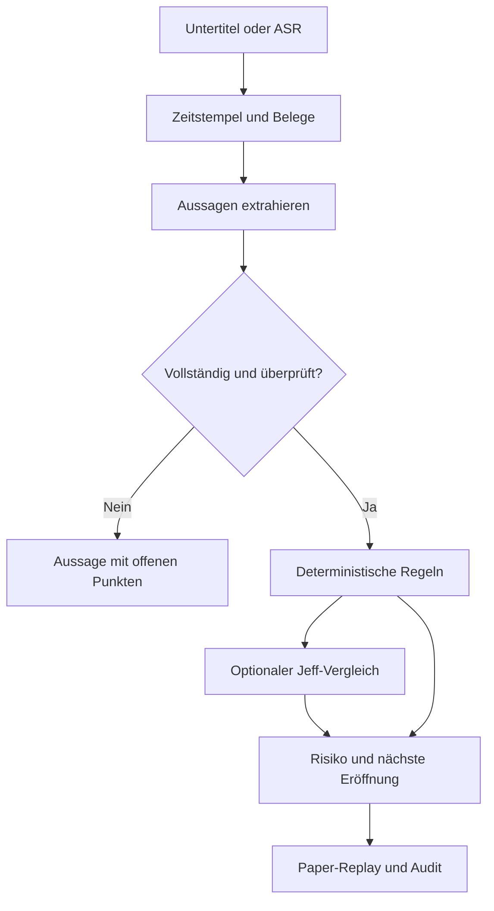

# Signal Decision Lab

Privater Research-Prototyp für **Trading-Aussagen aus Videos und Transkripten**, überprüfbare
bedingte Setups und **Decision Models wie Jeff**. Erstellt am 13. November 2026.

Die ausführbare Pipeline funktioniert offline. Sie erhält Belege und Zeitstempel, lässt
unbekannte Parameter offen und simuliert ausschließlich Paper-Trades. Eine profitable
Strategie aus Eric-Crown-Videos ist damit noch nicht nachgewiesen.

**Wichtigster Forschungsbefund:** Jeff ist hier ein optionaler Prüfer für eine eng definierte
Entscheidungsaufgabe. Der aktuelle Trading-Adapter ist kein Kursprognosemodell. Die echten
CPU-Tests in diesem Projekt rechtfertigen keine automatische Einstiegsfreigabe durch Jeff.
Die deterministische Regelbasis bleibt deshalb der Standard.

## In einer Minute starten

Python 3.11 oder neuer genügt für Demo und Verhaltenstests. Keine API-Schlüssel und keine
zusätzlichen Python-Pakete sind für diesen Weg erforderlich.

```bash
git clone https://github.com/larsmartens/signal-decision-lab.git
cd signal-decision-lab
git checkout draft/prototype
python -m signal_lab demo
python -m unittest discover -s tests -v
```

Öffne anschließend `artifacts/demo/report.html`. Der Bericht enthält sechs ausdrücklich
synthetische Aussagen, ihre Originaltexte, Prüfgründe, eine freigegebene Beispielsituation,
die Paper-Ausführung und eine Equity-Kurve. Die gewählte Preisfolge testet die Mechanik;
ihre Gewinne sind kein empirischer Nachweis.

Optional installiert `python -m pip install -e '.[dev]'` den Befehl `signal-lab`, Ruff und
Mypy. Standardausgabe ist kompaktes TOON; `--format json` liefert maschinenlesbares JSON.
Die vollständigen Ergebnisse stehen unabhängig davon in den gespeicherten JSON-Dateien.

## Was implementiert ist

| Bestandteil | Stand | Grenze |
|---|---|---|
| JSON-, WebVTT- und SRT-Import | Funktionsfähig und getestet | Publikations- und Verfügbarkeitszeit müssen angegeben werden. |
| YouTube-Untertitel | Optionaler Import; echter Abruf geprüft | Verfügbarkeit und Anbieterblockaden unterscheiden sich je Video/Umgebung. |
| Lokale Audio-/Video-Transkription | Optionaler `faster-whisper`-Adapter | Adapter vorhanden; tatsächlicher ASR-Modelllauf hier nicht geprüft. |
| Regelbasierte Extraktion | Funktionsfähig, konservativ | Englisch, BTC/ETH und eng begrenzte ausführbare Satzmuster. |
| Strukturierte LLM-Extraktion | HTTP-Adapter und negative Tests | Kein externer generativer Modellaufruf in dieser Sitzung; unstrukturierte Bedingungen bleiben gesperrt. |
| Belegprüfung und Freigabe | Funktionsfähig | Eine gespeicherte Freigabe dokumentiert eine ausdrückliche Handlung; sie beweist keine fachliche Richtigkeit. |
| Jeff-v1.4-Client | Aktueller API-Vertrag; tatsächliche CPU-Inferenz separat geprüft | Original-HTTP-Dienst mit Modell hier durch Unix-Socket-Beschränkung nicht vollständig geprüft. |
| Paper-Replay | Funktionsfähig | Ein Asset, eine Position, feste OHLC-Annahmen, keine Liquiditätssimulation. |
| Kalibrierung | Brier, ECE, Genauigkeit und Abdeckungsrate | Klassifikationsmetriken, keine Renditeprognosen. |
| HTML-Bericht | Responsives Layout, ohne externe Ressourcen | Darstellung im Browser und mobil hier nicht visuell geprüft; lokale Datei. |

## Architektur



Eine Aussage ist noch kein Setup. Ein Setup ist noch keine Order. Eine korrekt rekonstruierte
Order belegt noch keine profitable Strategie. Diese Übergänge haben getrennte Belege.

## Eigene Transkripte analysieren

Canonical JSON ist in `examples/synthetic-transcript.json` beschrieben. Für Untertitel
gibt es `examples/captions.vtt` und die Metadatenvorlage daneben.

```bash
python -m signal_lab extract examples/captions.vtt \
  --metadata examples/captions-metadata.json --out artifacts/claims.json
python -m signal_lab show artifacts/claims.json --full --format json
```

Die Beispielquellen liegen in der Vergangenheit und sind bei einem heutigen Import bereits
abgelaufen. Das ist beabsichtigt. `--as-of` ermöglicht ausdrücklich deklarierte historische
Verarbeitungsannahmen für Experimente; diese Annahmen sind kein Beweis damaliger Verfügbarkeit.
Der Ablaufpunkt bleibt an die ursprüngliche Publikation gebunden.

Nur ausdrücklich unterstützte Bedingungen können freigegeben werden, beispielsweise:

> Buy BTC if the 1h candle closes above 100; stop at 95; target 120; valid for 4 hours.

Dieses Beispiel ist selbst geschrieben und synthetisch. Aussagen mit weiteren Bedingungen,
Preisspannen, unaufgelösten Korrekturen, fehlendem Stop oder uneindeutiger Attribution bleiben
blockiert. Die LLM-Extraktion darf diese Grenze nicht umgehen. Eine spätere Erweiterung
braucht neue Schemafelder und passende Verhaltenstests, keine stillen Standardwerte.

Eine geprüfte, vollständige Aussage kann ausdrücklich freigegeben werden:

```bash
python -m signal_lab review --input artifacts/claims.json \
  --signal "<ID aus show>" --reviewer "<Prüfer>" --out artifacts/reviewed.json
python -m signal_lab replay --signals artifacts/reviewed.json \
  --bars examples/synthetic-bars.csv --policy examples/policy.json \
  --out artifacts/replay.json --report artifacts/replay.html
```

Die Preisdatei muss zum Asset, Zeitraum, Handelsplatz und Candle-Zeitrahmen deiner Quelle
passen. Die synthetischen Preise oben dienen nur dazu, das Dateiformat zu zeigen.

## YouTube, LLM und Audio als optionale Adapter

```bash
python -m pip install -e '.[youtube]'
python -m signal_lab import-youtube \
  --url 'https://www.youtube.com/watch?v=EdXslFg3u38' \
  --channel 'Cointelegraph: Krown interview' \
  --published-at '2026-09-02T15:01:27Z' --out data/interview.json
```

Dieser konkrete Abruf wurde mit 646 automatisch erzeugten englischen Segmenten geprüft.
Die Video-Publikationszeit stammt aus dem YouTube-Microformat. Der aktuelle Import erfasst
die tatsächliche Abrufzeit. Er simuliert keine Beobachtung im September. Die einfache
segmentweise Baseline fand 46 Asset-Erwähnungen, keine vollständig unterstützten Setups.
Das ist ein Importtest und kein manuell gelabelter Qualitätstest. Vollständige fremde
Transkripte und Modellgewichte werden nicht mit dem Repository verteilt.

Für einen eigenen generativen Extraktionsdienst:

```bash
export SIGNAL_LLM_BASE_URL='http://127.0.0.1:11434/v1'
export SIGNAL_LLM_MODEL='<installiertes Modell>'
python -m signal_lab extract data/interview.json --provider llm --out artifacts/llm-claims.json
```

Der Dienst muss Chat-Completions mit `response_format: json_object` unterstützen. Für einen
entfernten Dienst ist HTTPS erforderlich; Zugangsdaten kommen ausschließlich aus
`SIGNAL_LLM_API_KEY`. `.env.example` wird nicht automatisch geladen. Fehlgeschlagene
Modellaufrufe erzeugen keine erfundenen Ersatzsignale.

Für eigene lokale Audio-/Videodateien: `python -m pip install -e '.[asr]'`, danach
`python -m signal_lab transcribe --help`. Der erste ASR-Aufruf lädt das ausgewählte Modell.
Chartbilder/OCR sind in diesem Draft noch nicht implementiert.

## Jeff: experimenteller Anschluss

Installation, festgehaltene Version, tatsächliche Messergebnisse und Reproduktionsskript:
**[docs/JEFF_SETUP.md](docs/JEFF_SETUP.md)**.

```bash
export JEFF_BASE_URL='http://127.0.0.1:8765'
python -m signal_lab demo --judge jeff --out artifacts/jeff-comparison
```

Dies ist ein ausdrücklich ausgewähltes Paper-Filterexperiment. Ein Ausfall oder eine
Enthaltung führt zu keinem neuen Einstieg. Der Schalter startet oder installiert keine
Jeff-Runtime. Ohne erreichbaren, kompatiblen Dienst entsteht deshalb kein Trade.
Jeff kann deterministische Risiko- und Quellenprüfungen niemals überstimmen.

Die echte CPU-Untersuchung umfasst zwei Fälle mit dem implementierten Request und sechs
vorab definierte Fälle mit einer einmalig vereinfachten Darstellung. Im zweiten Satz
enthielt sich Jeff in allen sechs Fällen; zwei erste Labelentscheidungen waren falsch.
Die vereinfachte Variante wurde nicht übernommen. Das kleine Experiment begründet eine
vorsichtige Integrationsentscheidung, keine allgemeine Bewertung des Modells.

## Plan, Recherche und Belege

- [Umsetzungsplan](docs/PLAN.md): Phasen, Entscheidungen, Abnahmekriterien und nächster Schritt.
- [Evaluationsdesign](docs/EVALUATION.md): Goldstandard, zeitliche Trennung, Ablationen und Kalibrierung.
- [Jeff und Decision Models](docs/research/decision-models.md): aktuelle, versionierte Primärquellen.
- [Video- und Transkript-Systeme](docs/research/video-signals.md): geprüfte Implementierungen und Paper.
- [Validierung](docs/VALIDATION.md): ausgeführte Prüfungen und verbleibende Grenzen.
- [Spezifikation](docs/SPEC.md) und [Coding Standards](docs/CODING_STANDARDS.md).

**Nächster sinnvoller Schritt:** einen kleinen echten Krown-Korpus mit vollständigen Kontextfenstern
und menschlich geprüften Aussagen aufbauen; anschließend messen, ob die Videoeingaben gegenüber
einer reinen Preisdaten-Baseline einen zusätzlichen Nutzen haben. Erst aus diesen Daten ergibt
sich, welche eng definierte Decision-Model-Aufgabe sich zu trainieren lohnt.
