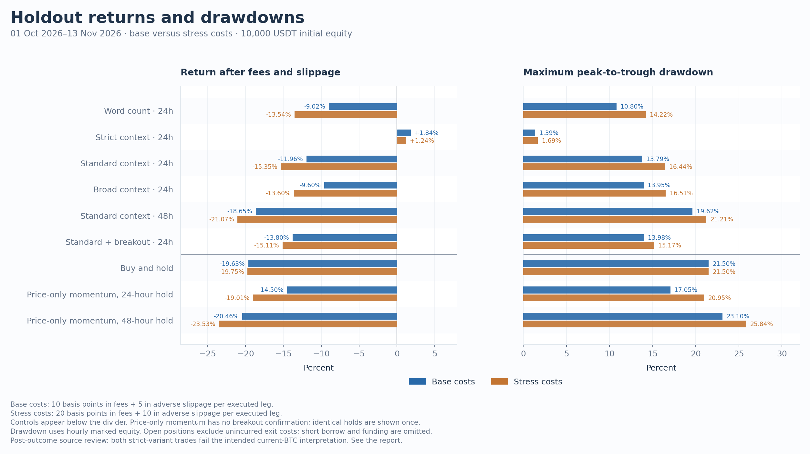
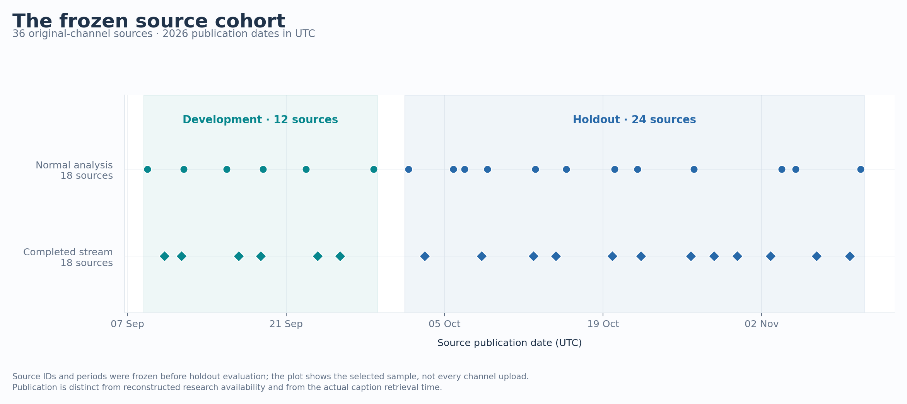
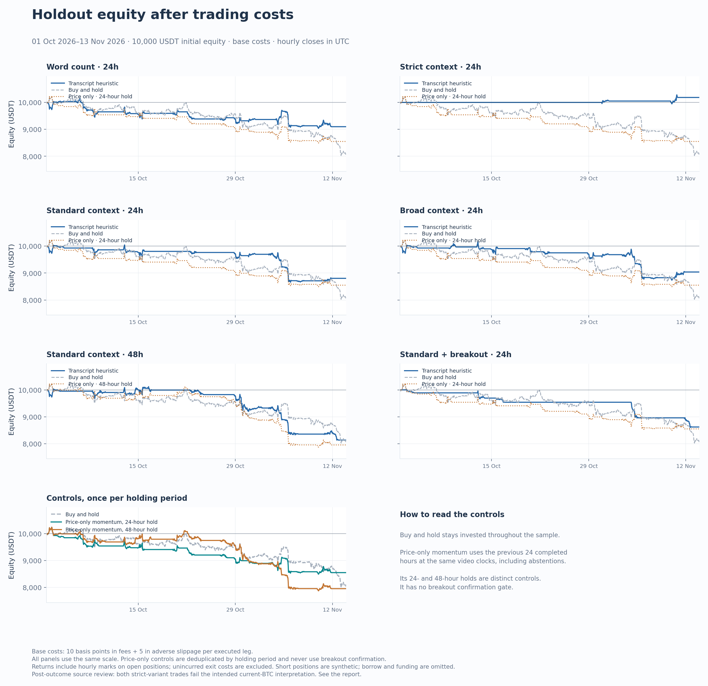
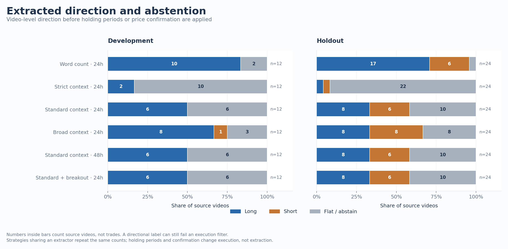

# Krown: 36 videos, six trading rules

This experiment processed 36 regular Bitcoin videos and completed livestreams from [Krown’s own channel](https://www.youtube.com/@ECKrown). It ran six fixed trading rules at two cost levels, first on twelve September sources and then on 24 untouched October–November sources. Every declared run is published.

**The results do not establish a useful trading signal.** Five of the six rules lost money in holdout. The strict rule returned +1.84% after base costs, but made only two trades. A subsequent review of their source passages found that both directions failed the intended interpretation: one mixed an indicator description with a conditional stance; the other attributed views on other assets to Bitcoin. The positive number is still reported, with that failure attached.

The execution calculations reproduce exactly. The main unresolved problem is whether the extracted direction means what the speaker said. These results measure a hand-written transcript heuristic with researcher-chosen holding periods; they are not Krown’s trading performance.



## Sources and market data

| Cohort | Source publication dates, UTC | Normal videos | Completed streams | Total | Recorded duration |
|---|---|---:|---:|---:|---:|
| Development | September 8–28, 2026 | 6 | 6 | 12 | 13.59 hours |
| Holdout | October 1–November 10, 2026 | 12 | 12 | 24 | 25.04 hours |

All 36 selected captions were acquired: 66,992 timestamped segments across 38 hours, 38 minutes and 18 seconds of source material. The provider marked 27 tracks as generated and nine as non-generated. These flags are recorded, not a claim that any track was checked against audio.

Discovery covered 120 IDs on the channel’s Videos and Live tabs. Exact watch-page metadata was available for 118; two pages returned a bot-verification sign-in response. Those failures remain recorded. Selection then used title, duration, publication order and content type. Equally spaced date ranks chose the sources within each type. Failed caption downloads would not have been replaced; none of the selected downloads failed.

The [source manifest](../../../experiments/krown-20261114/sources.json) records every selected ID, original URL, channel ID, exact publication time, duration and metadata hash. The [corpus record](../../research/krown-corpus.md) explains discovery and lists all 36 sources.

The market input is 3,263 consecutive hourly **Binance spot BTCUSDT** candles, from July 1 at 00:00 UTC through the completed November 13 candle ending at 23:00 UTC. There are no gaps or filled candles. Older bars provide causal indicator history; the actual trading windows begin in September and October. [Market provenance](../../../experiments/krown-20261114/market-provenance.json) retains request URLs, exchange time, normalization and checksums. Binance documents the endpoint in its [market-data API](https://developers.binance.com/en/docs/catalog/core-trading-spot-trading/api/rest-api/market#klinecandlestick-data).



## What was fixed before returns were measured

The [protocol](../../../experiments/krown-20261114/PROTOCOL.md) and [numeric configuration](../../../experiments/krown-20261114/protocol.json) were published before empirical backtests. The exact input-byte checkpoint is [5f4a3df](https://github.com/larsmartens/signal-decision-lab/commit/5f4a3df4c43ba47d5fca5d8f6d0066d3594f1f93). The extractor was then fixed at [cdd54f9](https://github.com/larsmartens/signal-decision-lab/commit/cdd54f97b18745d5beb568a219d40619552197ad), after development-only language corrections and synthetic counterexamples, before opening the holdout captions.

| Variant | Extracted view | Execution rule |
|---|---|---|
| Word count | Balance of positive and negative vocabulary near a Bitcoin reference | Hold 24 hours |
| Strict context | Explicit current stance or expectation; at least two textual units and 0.50 dominance | Hold 24 hours |
| Standard context | Also admits present market descriptions; at least one unit and 0.25 dominance | Hold 24 hours |
| Broad context | Also admits bounded and tentative expectations; at least one unit and 0.10 dominance | Hold 24 hours |
| Standard, longer hold | Same standard extraction | Hold 48 hours |
| Standard with breakout | Same standard extraction | Wait at most 24 hours for a completed close beyond the preceding 24-hour high/low, then hold 24 hours |

The directional score is the difference between positive and negative weights divided by their total. It is a textual balance score, not a probability. A tie or failed threshold produces an abstention. “Two units” means two normalized clauses, not two independent forecasts. The [extraction record](../../research/krown-extraction.md) gives all windows, rule weights, exclusions and known limits.

Each cohort starts with 10,000 USDT. Only one position or pending setup may exist. New events that overlap are recorded and skipped. A position allocates the available equity including entry fees; there is no leverage. The 24/48-hour horizons and BTCUSDT market mapping are choices made for this study, not source-authored trading instructions.

Base costs charge 0.10% fees plus 0.05% adverse slippage on **each executed leg**. Stress costs double both: 0.20% plus 0.10% per leg. Fees and slippage affect the actual fills and equity. Cash earns no interest. Long/short P&L uses a synthetic directional position on spot prices; borrowing, funding, margin and liquidation mechanics are omitted.

## Holdout results

The trading window is **October 1, 19:00 UTC to November 13, 23:00 UTC**. Returns use final equity after incurred costs. Drawdown is the largest peak-to-trough loss at hourly closes. “Trades” counts completed positions; buy-and-hold remains open and marked at the last completed close.

| Rule | Base return | Stress return | Base max drawdown | Completed trades | Time invested |
|---|---:|---:|---:|---:|---:|
| Word count · 24h | -9.02% | -13.54% | 10.80% | 17 | 39.38% |
| Strict context · 24h † | +1.84% | +1.24% | 1.39% | 2 | 4.63% |
| Standard context · 24h | -11.96% | -15.35% | 13.79% | 13 | 30.12% |
| Broad context · 24h | -9.60% | -13.60% | 13.95% | 15 | 34.75% |
| Standard context · 48h | -18.65% | -21.07% | 19.62% | 10 | 46.33% |
| Standard + breakout · 24h | -13.80% | -15.11% | 13.98% | 5 | 11.58% |
| Buy and hold | -19.63% | -19.75% | 21.50% | 0 | 100.00% |
| Price momentum, 24-hour hold | -14.50% | -19.01% | 17.05% | 18 | 41.70% |
| Price momentum, 48-hour hold | -20.46% | -23.53% | 23.10% | 13 | 60.23% |

† Both strict-rule source interpretations failed the subsequent context review described below. Its positive return is not evidence of accurately extracted profitable views.

The price-only rule takes the sign of the preceding 24 completed hourly candles at the same video availability clocks, including clocks where the transcript abstains. It uses the same holding period and costs, with no breakout gate. Consequently this comparison captures both direction selection and abstention behavior. It does not isolate a pure language effect with identical market exposure.

The strict rule spent 95.37% of this window in cash. Its low drawdown is therefore not comparable to a continuously invested portfolio without that qualification. No Sharpe ratio, annualized return or significance claim is used for these short, overlapping samples.



## Why the two profitable strict trades do not validate extraction

The two profitable strict trades were selected for a diagnostic review after outcomes were known. Separate analysis passes examined all six accepted units and surrounding captions; neither involved human reference labeling or audio verification. The source hashes matched. This is an explanation of observed failures, not an estimate of precision or recall.

| Source | Frozen output | What the supporting passages actually concern |
|---|---|---|
| October 30, [14:05](https://www.youtube.com/watch?v=_mBMq8jYOY8&t=845s) and [1:39:46](https://www.youtube.com/watch?v=_mBMq8jYOY8&t=5986s) | Long; +51.41 USDT in the simulation | An indicator band’s relative position, followed much later by bullishness conditional on a recovery level. Neither passage supplies the required unconditional current long view. |
| November 9, [08:40](https://www.youtube.com/watch?v=_vVNNnKqdDw&t=520s), [46:36](https://www.youtube.com/watch?v=_vVNNnKqdDw&t=2796s) and [46:47](https://www.youtube.com/watch?v=_vVNNnKqdDw&t=2807s) | Short; +132.76 USDT in the simulation | The negative units concern MSTR/MSTZ and Monero. Bitcoin is a comparison or an explicitly separate subject. Two Monero sentences repeat one economic view. A later BTC bounce expectation does not support the aggregate short. |

The finite asset dictionary missed those instruments. A nearby Bitcoin mention became the subject by default; an unfamiliar conditional construction and an indicator comparison also escaped the context rules. Exact quoted evidence and correct offsets alone cannot verify this semantic relationship.

If those invalid units were discarded without adding new ones, both strict outputs would fail their existing support requirement. That is diagnostic counting, **not a corrected backtest**. The original rules, features and returns remain unchanged so the failure stays reproducible. [Machine-readable diagnostic](../../../experiments/krown-20261114/diagnostics.json).

## Extraction coverage

| Extractor | Development: long / short / flat | Holdout: long / short / flat |
|---|---:|---:|
| lexical | 10 / 0 / 2 | 17 / 6 / 1 |
| context_strict | 2 / 0 / 10 | 1 / 1 / 22 |
| context_standard | 6 / 0 / 6 | 8 / 6 / 10 |
| context_broad | 8 / 1 / 3 | 8 / 8 / 8 |

These are modelled video-level labels before overlap and execution rules. They are not reviewed instructions. The literal setup extractor found 1,950 asset mentions and **zero complete supported setups** under its small caption-segment grammar. This says what that extractor found; it does not prove that the videos contain no actionable statements. No claim was automatically reviewed.



## Development results

The development trading window is September 8, 18:00 UTC to October 1, 19:00 UTC. It starts with its own 10,000 USDT. These are separate portfolio runs: their returns must not be added to holdout returns as though positions carried across the boundary.

| Rule | Base return | Stress return | Base max drawdown | Completed trades |
|---|---:|---:|---:|---:|
| Word count · 24h | -3.94% | -6.50% | 5.32% | 9 |
| Strict context · 24h | +0.04% | -0.56% | 1.01% | 2 |
| Standard context · 24h | -3.43% | -5.15% | 4.81% | 6 |
| Broad context · 24h | -3.52% | -5.81% | 4.91% | 8 |
| Standard context · 48h | -1.33% | -2.80% | 4.10% | 5 |
| Standard + breakout · 24h | -2.02% | -2.61% | 2.70% | 2 |

Development buy-and-hold returned +7.86% at base costs; the 24-hour and 48-hour price-only controls returned −2.76% and −4.30%. Thresholds were not selected from these returns. Semantic corrections used only development captions and synthetic language cases before any empirical returns were computed.

## Time assumptions and limits

Actual caption retrieval took place on November 13, 2026, between 23:14:40 and 23:15:41 UTC. The simulation reconstructs earlier availability: normal-video publication plus full duration plus 15 minutes; completed-stream availability is the later of archive publication and verified stream end plus 15 minutes. Entry is the next hourly open strictly after that reconstructed time. This processes a complete archive. It does not simulate listening during a live stream.

Current captions and verified publication metadata do not prove that identical captions were accessible at the historical decision time. Full-video aggregation also mixes short and long horizons. The dataset spans one short period in one instrument, with correlated commentary and an October–November price decline. Equal counts of videos and streams are a sampling choice, not the channel’s natural publication mix.

No Jev inference, generative extraction, ASR, chart-image reading, live order or prospective shadow run was performed in this experiment. The existing Jev adapter remains separately tested against local HTTP fixtures. It is not a tested factor in these return tables.

## Reproduce the published run

Python 3.11 or later is sufficient for the numeric replay. It reads the published feature snapshot and hourly candles; it needs no network, API key or transcript service.

```bash
python -m signal_lab krown-study --out artifacts/krown-replay --format json
python scripts/check_study_reproduction.py --actual artifacts/krown-replay
```

To regenerate all four figures in PNG and SVG:

```bash
python -m pip install -e '.[research]'
python -m signal_lab krown-study --out artifacts/krown-replay \
  --charts artifacts/krown-replay/charts --format json
```

The charts use [Matplotlib](https://matplotlib.org/stable/users/explain/quick_start.html), pinned to 3.10.8 for this experiment. All axes, legends and cost scenarios are drawn from saved result records.

Re-extraction needs the exact original canonical caption files, which are deliberately not redistributed. With that cache present, use `--transcripts data/krown/transcripts`. The runner checks their recorded hashes, retrieval times and the frozen extractor code. Downloading captions today produces a new acquisition record and requires a new study; it is not an exact replay of the old source snapshot. Acquisition commands are in the [corpus record](../../research/krown-corpus.md).

| Artifact | Contents |
|---|---|
| [results.csv](../../../experiments/krown-20261114/results.csv) | All 24 strategy summary rows |
| [summary.json](../../../experiments/krown-20261114/summary.json) | Coverage, controls, configuration provenance and artifact hashes |
| [source-views.csv](../../../experiments/krown-20261114/source-views.csv) | Every per-source label, score, time and evidence link |
| [features.json](../../../experiments/krown-20261114/features.json) | Frozen numeric features and accepted span references; no caption text |
| [trades.csv](../../../experiments/krown-20261114/trades.csv) | Completed strategy trades with costs and timestamps |
| [runs](../../../experiments/krown-20261114/runs) and [benchmarks](../../../experiments/krown-20261114/benchmarks) | Full event, trade, equity, drawdown and per-video records |
| [market-bars.csv](../../../experiments/krown-20261114/market-bars.csv) | Exact hourly price snapshot |
| [validation.json](../../../experiments/krown-20261114/validation.json) | Observed tests, independent accounting audit and reproduction result |

## What to change next

The next extractor needs explicit subjects, conditions and time horizons. Unknown assets must remain unknown instead of borrowing a nearby BTC reference. Indicators need to be distinguished from forecasts, and paraphrases of one view should not create several supporting votes. Validate those changes on newly selected sources with independent reference labels before another return comparison.

Jev could then judge a narrow decision over that structured state: whether a specific, reviewed condition is satisfied by the completed market data and permits an entry. It should retain abstention and cannot repair an incorrectly attributed source claim by assigning a high score. A useful next comparison would keep the same reviewed inputs and execution rules, with Jev as a separately measured filter. The current holdout has now been examined and cannot be reused as untouched evidence for that next version.
